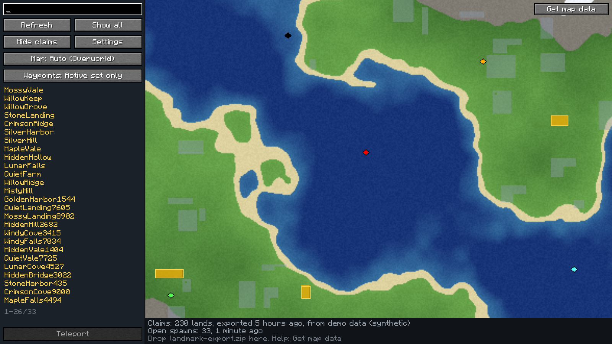
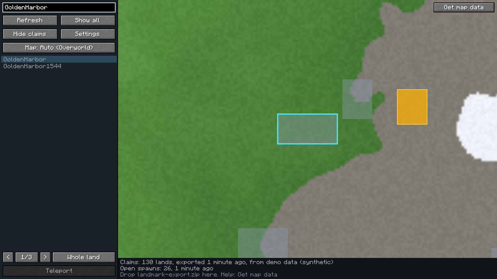
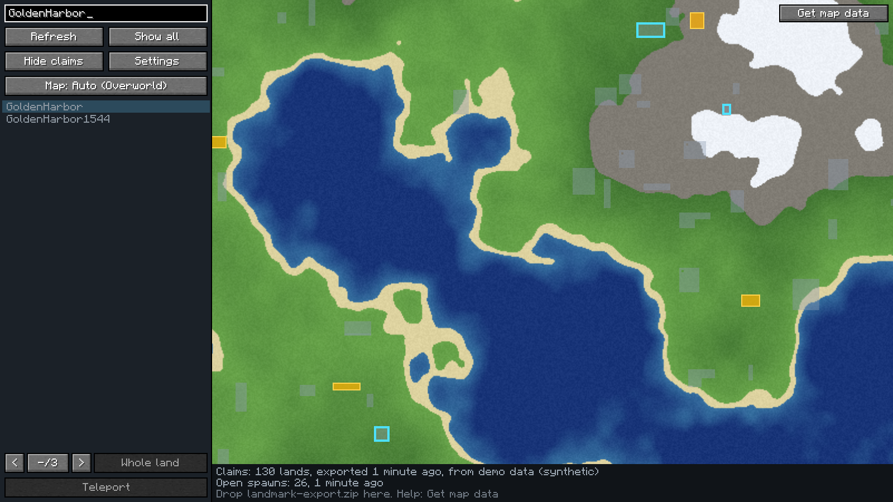

# Landmark

An in-game map of land claims for fast `/lands spawn <land>` teleporting. A client-side Fabric mod for Minecraft 1.21 to 26.3.

> Not affiliated with or endorsed by Chillzone or the Lands plugin.

Press `M` (rebindable) in a world to open the map. Lands with a public spawn are highlighted. Click one, confirm, and the
mod runs `/lands spawn <name>` for you.

## Lands in several sections

A land can be made of sections far apart. Searching for or selecting one opens the map on a single section: the one with the
land's known spawn, otherwise the biggest. The row of buttons at the bottom of the side panel steps through the rest (**<**,
the section number, **>**), and **Whole land** fits them all.

## Start here

- [[Installation]]: which jar, which Java and Fabric Loader.
- [[Getting the map data]]: the one-time export from the web map.
- [[Settings]]: keybinds, features, export quality, colours, `config/landmark.json`.
- [[Waypoints]]: Xaero's Minimap and JourneyMap, sets, and Overworld/Nether conversion.
- [[Troubleshooting]]: common problems and what to check.
- [[Privacy]]: what stays on your computer and what is sent.
- [[For maintainers]]: building, eras, adding a Minecraft version.

## Links

- Source and issues: <https://github.com/TrojanHorsePower/Landmark>
- Releases (the jars): <https://github.com/TrojanHorsePower/Landmark/releases>
- Changelog: <https://github.com/TrojanHorsePower/Landmark/blob/main/CHANGELOG.md>
- Website: <https://trojanhorsepower.github.io/Landmark/>
- CurseForge: <https://www.curseforge.com/minecraft/mc-mods/landmark-map>
<!-- Placeholder: uncomment and fill in when the Modrinth page exists.
- Modrinth: https://modrinth.com/mod/PROJECT-SLUG
-->

## About

Landmark was written with the help of Claude Code, an AI coding assistant, and is tested and reviewed by its maintainer.
The unit tests, the CI build on every supported Minecraft version range and checks against a real game client are what the
code is verified by. [MIT licensed](https://github.com/TrojanHorsePower/Landmark/blob/main/LICENSE).
